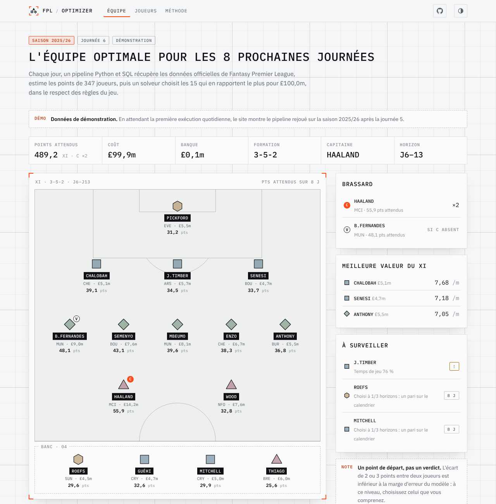
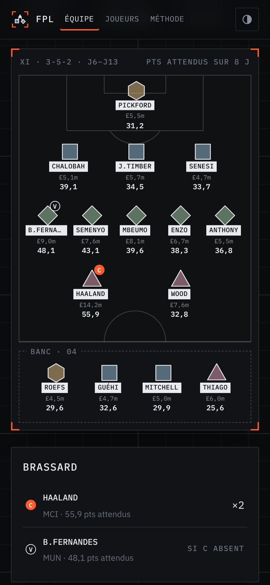

# FPL Optimizer

Pipeline de données en **Python et SQL** qui choisit chaque jour l'équipe optimale de
[Fantasy Premier League](https://fantasy.premierleague.com) : collecte des données
officielles, base SQLite, modèle de points attendus, optimisation linéaire sous les
règles du jeu, puis publication sur un site Next.js.



| Sur téléphone | Backtest sur une saison jamais vue |
|---|---|
|  |  |

## En bref

- **Collecte :** l'API publique de FPL, avec reprises sur erreur et cache. Le pipeline lit les statistiques journée par journée au lieu de joueur par joueur : **2 requêtes par jour** au lieu d'environ 750.
- **SQL :** les réponses sont chargées dans SQLite (6 tables), et les variables du modèle sont calculées par des vues : jointures, agrégats, sous-requêtes, `ROW_NUMBER() OVER (PARTITION BY …)`.
- **Modèle :** points attendus sur les 8 prochaines journées, à partir des trois saisons passées et de la saison en cours, du temps de jeu, du jeu produit (xG, xA) et du calendrier.
- **Optimisation :** programme linéaire en nombres entiers (PuLP, solveur HiGHS) : budget, quotas par poste, 3 joueurs par club au plus, XI valide.
- **Validation :** chaque constante est confrontée aux saisons 2023-24 et 2024-25 ; le pipeline complet est ensuite rejoué sur **2025-26**, saison qu'il n'a jamais vue. Résultat : **2 527 points** sur 48 journées, contre 2 305 pour l'équipe la plus sélectionnée par les joueurs (+9,6 %), meilleur 5 fois sur 6.
- **Automatisation :** GitHub Actions lance le pipeline chaque matin et commite les résultats ; Vercel reconstruit le site.

## Architecture

```
API FPL ──► pipeline/api.py ──► cache JSON (data/cache/)
                    │
                    ▼
           SQLite en mémoire ◄── pipeline/sql/schema.sql
                    │            pipeline/sql/features.sql (vues)
                    ▼
           pipeline/model.py      points attendus (pandas)
                    │
                    ▼
           pipeline/optimize.py   PuLP + HiGHS
                    │
                    ▼
           web/public/data/latest.json + fpl_expected_points.csv
                    │
                    ▼
           web/ (Next.js)  ──► Vercel
```

| Dossier | Contenu |
|---|---|
| `pipeline/` | Le pipeline : client API, chargement SQL, modèle, solveur, export. |
| `pipeline/sql/` | Le schéma et les requêtes : `features.sql` contient les variables du modèle. |
| `backtest/` | `indicators.py` valide les constantes ; `pipeline_backtest.py` rejoue une saison entière. |
| `scripts/build_replay.py` | Reconstruit l'API telle qu'elle était un jour donné, à partir des archives publiques. |
| `tests/` | Tests unitaires (SQL, modèle, reprises HTTP) et un test de bout en bout. |
| `web/` | Le site : terrain avec banc, fiches joueurs, tableau filtrable, page Méthode. |

## Lancer le pipeline

```bash
pip install -r requirements.txt
python -m pipeline                     # API officielle -> web/public/data/
python -m pipeline --db fpl.sqlite     # garde aussi la base pour l'explorer
python -m pipeline --budget 99.5 --force 430,449 --exclude 381
python -m pytest -q
```

Options utiles : `--horizon` (journées couvertes, 8 par défaut), `--budget`, `--force` et
`--exclude` (identifiants FPL), `--current-weight` (poids de la saison en cours).
Un fichier `overrides.csv` facultatif (`player_id,minute_share`) impose un temps de jeu :
`0` écarte un joueur.

La base produite par `--db` s'ouvre avec n'importe quel client SQLite :

```sql
SELECT name, team, cur_minutes, ROUND(conc, 2) AS conc, team_conv
FROM v_player_features
ORDER BY total_points DESC
LIMIT 10;
```

## Backtests

```bash
# Constantes du modèle (télécharge les archives vaastav/Fantasy-Premier-League)
python backtest/indicators.py --json web/public/data/backtest.json

# Pipeline complet rejoué sur une saison
python backtest/pipeline_backtest.py --season-dir ARCHIVE/2025-26 \
    --past ARCHIVE/2024-25.csv ARCHIVE/2023-24.csv \
    --json web/public/data/pipeline_backtest.json
```

Ce que les backtests ont changé : la part de minutes est le meilleur indicateur (corrélation
0,40 à 0,55 avec les points futurs), le mélange optimal entre points réels et jeu produit est
d'environ 70 % de xG, le filtre « joueur en surchauffe » a été retiré (ces joueurs marquaient
*plus* que les autres) et le calendrier ne pèse presque rien sur 8 journées.

## Le site

```bash
cd web
npm install
npm run dev        # http://localhost:3000
```

Le site lit `web/public/data/latest.json` à la compilation. Sans données réelles, il affiche
`demo.json`, le pipeline rejoué sur 2025-26 après la journée 5, avec un bandeau
« Démonstration ».

## Mise en ligne

1. **Vercel :** importer le dépôt, *Root Directory* = `web`, le reste par défaut.
2. **GitHub :** onglet *Actions* → « Données quotidiennes » → *Run workflow* pour la première
   exécution. Ensuite, elle tourne chaque matin à 5 h 17 UTC.
3. Si l'API FPL refuse les serveurs de GitHub (réponse 403), lancer `python -m pipeline` sur
   son ordinateur puis commiter `web/public/data` et `data/cache` : le site se met à jour de
   la même façon.

## Limites

Le modèle classe les joueurs, il ne tranche pas entre deux joueurs à 2 ou 3 points d'écart :
c'est sous sa marge d'erreur. Le backtest ne simule ni transferts, ni remplacements
automatiques, ni blessures annoncées. Projet personnel, sans lien avec la Premier League.
