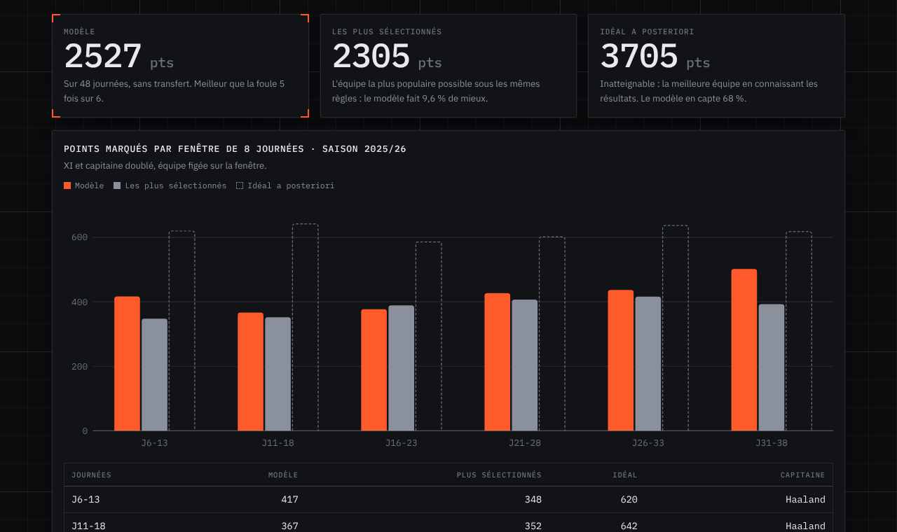

# FPL Optimizer

Pipeline de données en **Python et SQL** qui choisit l'équipe optimale de
[Fantasy Premier League](https://fantasy.premierleague.com) : collecte quotidienne des
données officielles, base SQLite, modèle de points attendus, optimisation linéaire sous les
règles du jeu, et un site pour l'explorer.

**Site : [fpl-optimizer-beta.vercel.app](https://fpl-optimizer-beta.vercel.app)**


## Ce que fait le projet

- **Collecte** de l'API publique FPL chaque matin (GitHub Actions), avec cache et reprises sur erreur : 2 requêtes par jour au lieu d'environ 750.
- **Nettoyage et variables en SQL** : six tables SQLite, puis des vues avec jointures, agrégats, sous-requêtes et fonctions de fenêtre ([`features.sql`](pipeline/sql/features.sql)).
- **Modèle** de points attendus par joueur et par journée : temps de jeu projeté, niveau sur trois saisons et sur la saison en cours, xG et xA, calendrier.
- **Optimisation** par programmation linéaire en nombres entiers (PuLP, HiGHS) : budget, quotas par poste, 3 joueurs par club au plus, onze valide, capitaine.
- **Site** (Next.js) : choix de la période et du budget, joueurs imposés ou exclus, et import de son équipe FPL (lecture seule, sans mot de passe) pour obtenir les transferts conseillés, pénalités comprises. Le solveur tourne dans le navigateur (HiGHS en WebAssembly).

## Résultat

Les constantes ont été réglées sur 2023-24 et 2024-25. Le pipeline complet a ensuite été
rejoué sur **2025-26**, saison qu'il n'avait jamais vue : à six moments de la saison, il
choisit son équipe avec les seules données du jour, puis on compte ses points réels sur les
8 journées suivantes.

| Équipe | Points sur 48 journées |
|---|---|
| Modèle | **2 527** |
| Les plus sélectionnés par les joueurs FPL | 2 305 |
| Idéal a posteriori (inatteignable) | 3 705 |

Le modèle fait 9,6 % de mieux que la foule et la bat 5 fois sur 6. Le test ignore
transferts et remplacements automatiques.



## Organisation

| Dossier | Contenu |
|---|---|
| [`pipeline/`](pipeline) | Client API, chargement SQL, modèle, solveur, export JSON et CSV |
| [`pipeline/sql/`](pipeline/sql) | Schéma et requêtes |
| [`backtest/`](backtest) | Validation des indicateurs et rejeu d'une saison complète |
| [`tests/`](tests) | Tests unitaires (SQL, modèle, reprises HTTP) et de bout en bout |
| [`web/`](web) | Le site |

## Lancer en local

```bash
pip install -r requirements.txt
python -m pipeline                    # données du jour -> web/public/data/
python -m pipeline --db fpl.sqlite    # garde aussi la base SQLite pour l'explorer
python -m pytest -q

cd web && npm install && npm run dev  # http://localhost:3000
```

Le CSV complet de chaque exécution est téléchargeable depuis la page Joueurs du site.
